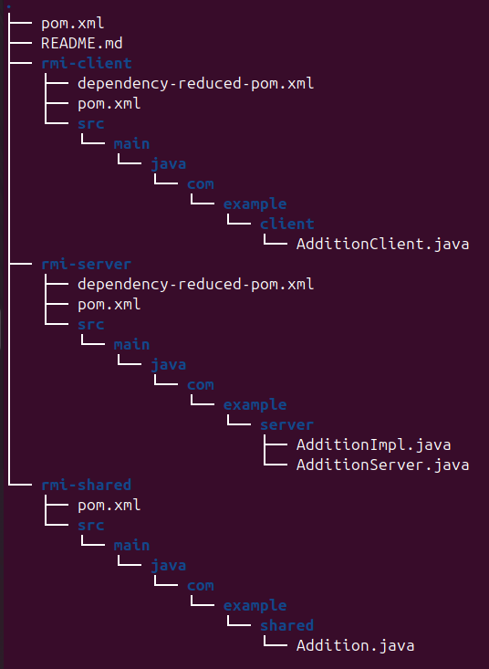

# RMI Addition

This is a Maven project for a Java RMI (Remote Method Invocation) application. The project consists of a server that provides an RMI service to add two numbers and a client that calls this service.

## Project Structure

The project is organized as follows:



## Explanation of Each Part

### 1. rmi-shared
- Defines a remote method `add` that takes two integers and returns their sum.

### 2. rmi-server
- Sets up an RMI registry on port 1099 and binds the `AdditionService` so clients can look it up.
- Implements the `Addition` interface and provides the actual logic for the `add` method.

### 3. rmi-client
- Connects to the RMI registry on localhost, retrieves the `AdditionService`, and calls the `add` method with two numbers.

## Running the Project

### 1. Compile and package
```bash
mvn clean install
```

### 2. Run the server
Do **not** start `rmiregistry` manually. The server creates (or reuses) the registry on port `1099`.

```bash
java -jar rmi-server/target/rmi-server-1.0-SNAPSHOT.jar
```

### 3. Run the client
```bash
java -jar rmi-client/target/rmi-client-1.0-SNAPSHOT.jar
```

If the server connects to an already-running external `rmiregistry` that does not have `rmi-shared` on its classpath, registration can fail with:
`ClassNotFoundException: com.example.shared.Addition`.
In that case, stop the external registry and run only the server command above.

License
This project is licensed under the MIT License - see the LICENSE file for details.